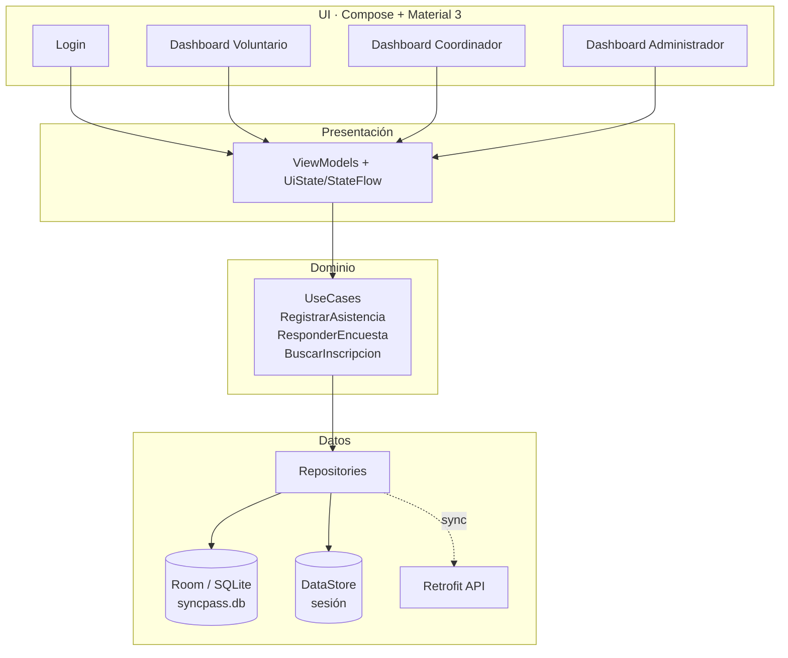
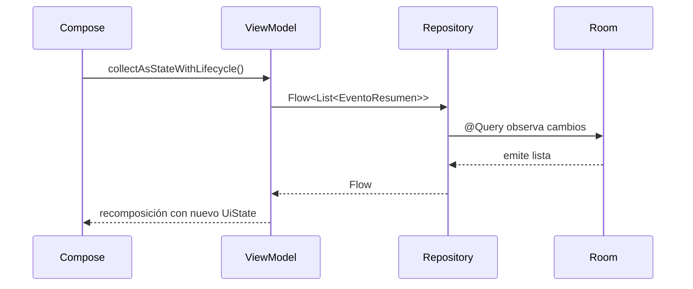
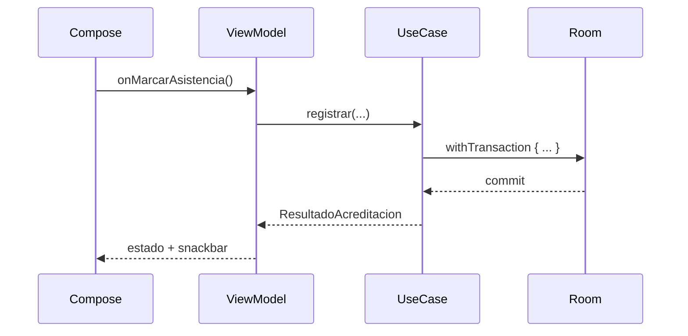
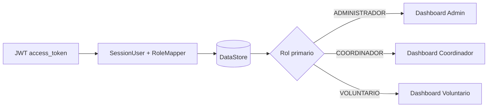
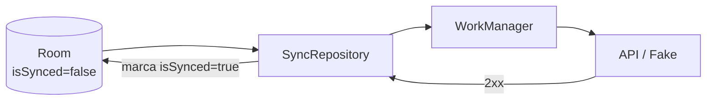

# 01 — Arquitectura Offline-First

> **Fase:** 0  
> **Estado:** congelada para la v1  
> **Objetivo:** definir capas, dependencias y reglas de consistencia antes de implementar Room.

---

## 1. Principios

1. **Room es la fuente de verdad local.** La UI lee siempre de Room; la red solo sincroniza.
2. **La UI no espera a la red para operar.** Login, lectura de eventos, marcación y encuesta funcionan sin conexión dentro de la gracia de sesión.
3. **Toda escritura local se marca como pendiente.** `isSynced = false` + `updatedAt` en la misma transacción.
4. **La sincronización es idempotente.** Los IDs creados en cliente son UUID/String; el servidor debe hacer upsert por ID.
5. **El hilo principal no toca SQLite.** DAOs `suspend`/`Flow`, repositorios con `Dispatchers.IO` cuando corresponda.
6. **Una sola fuente de estado por pantalla.** `UiState` inmutable + `StateFlow`; eventos de UI como funciones.
7. **La accesibilidad es parte del flujo.** 48 dp mínimo, texto legible, acciones al alcance de una mano.

---

## 2. Capas



### Responsabilidades

| Capa | Responsabilidad | No debe hacer |
|---|---|---|
| UI | Renderizar estado, capturar eventos, pedir permisos | Acceder a DAOs o decidir reglas de negocio |
| ViewModel | Orquestar estado y llamar use cases/repositorios | Contener SQL ni lógica de transacción |
| Dominio | Reglas de acreditación, encuesta, geofence, validaciones | Conocer Compose ni Android UI |
| Datos | Room, DataStore, Retrofit, mapeos | Decidir navegación |
| Core | Utilidades puras: tiempo, IDs, geolocalización, sesión | Depender de la UI |

---

## 3. Estructura de paquetes

```text
com.rojas.syncpass/
├── SyncPassApplication.kt
├── MainActivity.kt
├── di/
│   └── AppContainer.kt
├── core/
│   ├── database/
│   │   ├── AppDatabase.kt
│   │   └── Converters.kt
│   ├── time/TimeProvider.kt
│   ├── id/IdProvider.kt
│   ├── location/GeoUtils.kt
│   └── session/
│       ├── SessionRepository.kt
│       └── RoleMapper.kt
├── data/
│   ├── local/
│   │   ├── entity/
│   │   ├── dao/
│   │   ├── relation/
│   │   ├── projection/
│   │   └── seed/SeedData.kt
│   ├── repository/
│   └── remote/
├── domain/
│   ├── model/
│   └── usecase/
└── ui/
    ├── login/
    ├── home/
    ├── volunteer/
    ├── coordinator/
    ├── admin/
    └── components/
```

---

## 4. Flujo de datos

### Lectura



### Escritura offline



---

## 5. Reglas de escritura offline

1. Toda fila creada o modificada localmente actualiza `updatedAt` y deja `isSynced = false`.
2. Las filas descargadas del servidor o del seed se insertan con `isSynced = true`.
3. La acreditación se ejecuta en una transacción; si falla, no quedan participantes/inscripciones huérfanas.
4. La encuesta se puede responder después de sincronizar; eso vuelve a marcar la asistencia como pendiente.
5. No se borra historial con asistencias. Se usan estados de cancelación/finalización.
6. Las operaciones de sincronización nunca escriben directamente en la UI: actualizan Room y la UI reacciona.

---

## 6. Inyección de dependencias

Se usa un contenedor manual para reducir dependencias y riesgos de build:

```kotlin
class SyncPassApplication : Application() {
    lateinit var container: AppContainer
        private set

    override fun onCreate() {
        super.onCreate()
        container = AppContainer(this)
    }
}

class AppContainer(context: Context) {
    private val database = AppDatabase.getInstance(context)
    val usuarioRepository = UsuarioRepository(database.usuarioDao())
    val asistenciaRepository = AsistenciaRepository(database.asistenciaDao())
    val registrarAsistencia = RegistrarAsistenciaUseCase(database, ...)
}
```

Los ViewModels reciben el contenedor mediante factories. No se usa Hilt en v1.

---

## 7. Sesión y roles



- `SessionUser.roles` se mapea con prioridad `ADMINISTRADOR > COORDINADOR > VOLUNTARIO`.
- Rol desconocido → `VOLUNTARIO` (mínimo privilegio).
- Se persiste `access_token`, `userId`, `username`, `rol`, `expiresAt`, `savedAt`.
- **Gracia offline:** 8 horas después de `exp` para permitir trabajo en terreno. Pasada la gracia, se exige login.
- Producción requeriría refresh token; queda como deuda documentada.

---

## 8. Sincronización



- Orden: proyectos → eventos → participantes → inscripciones → asistencias.
- Idempotencia por UUID de cliente.
- `NetworkType.CONNECTED` + backoff exponencial.
- Fallo parcial: solo se marca lo confirmado por el servidor.
- UI muestra pendientes y último error; nunca bloquea la marcación local.

---

## 9. Concurrencia y errores

| Situación | Manejo |
|---|---|
| Doble marcación | Transacción + `UNIQUE(inscripcionId)` + `SQLiteConstraintException` → `YaAcreditado` |
| Escritura concurrente | `RoomDatabase.withTransaction` |
| Red caída | Room sigue operativo; sync queda pendiente |
| GPS denegado | Se marca con coordenadas `null` y advertencia |
| Cámara denegada | Entrada manual de token |
| Token expirado | Gracia offline; aviso; login al reconectar |
| DB con schema viejo | Migración explícita o fallback destructivo solo debug/pre-release |

---

## 10. Seguridad y privacidad

- Datos 100 % ficticios en seed y demos.
- No se registran tokens ni contraseñas en logs de producción.
- `HttpLoggingInterceptor` en debug debe redactar `Authorization` y el body de login (mejora en Fase 5/10).
- DataStore no está cifrado; se documenta como limitación de MVP.
- QR v1 es un token local; producción requiere QR firmado/rotativo con TTL.
- La DB no está cifrada; producción con PII real requiere SQLCipher.

---

## 11. UX para terreno

- Mínimo **48 dp** en botones, filas, íconos y chips interactivos.
- Acción principal anclada abajo; navegación inferior para una mano.
- Mensajes grandes y claros: “Acreditado”, “Ya estaba acreditado”, “Sin conexión”, “Pendiente de sync”.
- Feedback háptico/visual al escanear.
- Fuente escalable y tema oscuro.
- Nunca bloquear la marcación por falta de GPS, red o cámara: ofrecer fallback.

---

## 12. Decisiones registradas (ADR resumido)

| # | Decisión | Alternativa descartada | Motivo |
|---|---|---|---|
| 1 | Room como fuente de verdad | Cache en memoria | Persistencia offline real |
| 2 | IDs String/UUID | AutoIncrement | Sync sin colisiones |
| 3 | `isSynced`/`updatedAt` en todas las entidades mutables | Solo en asistencia | CRUD offline coherente |
| 4 | DataStore para sesión | SharedPreferences / solo memoria | API moderna y Flow |
| 5 | Navigation Compose desde Fase 6 | Solo estado | Back stack y dashboards |
| 6 | CameraX + ML Kit bundled | Solo token manual | Requisito de escaneo offline |
| 7 | `LocationManager` nativo | Play Services | Menos dependencias, offline |
| 8 | AppContainer manual | Hilt | Menos complejidad de build |
| 9 | FK `RESTRICT` + estados | Borrado en cascada | Auditoría e historial |
| 10 | KSP 2.3.10 | KSP 2.2.10 + flag | Build limpio con AGP 9 |
