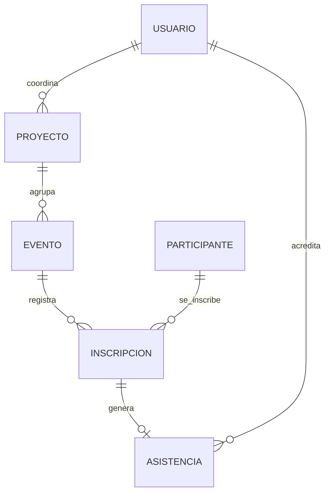
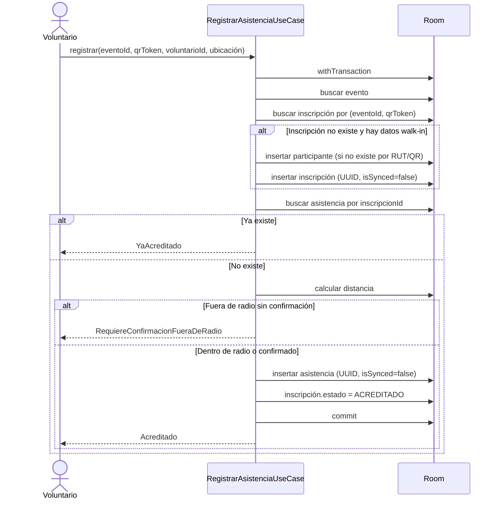

# 02 — MER y decisiones de persistencia

> **Fase:** 0  
> **Estado:** esquema congelado para la v1  
> **Objetivo:** documentar el modelo entidad-relación, las decisiones de desnormalización y las invariantes que la DB debe proteger.

---

## 1. MER conceptual



### Lectura del modelo

- Un **usuario** puede coordinar varios proyectos.
- Un **proyecto** agrupa varios eventos/talleres.
- Un **evento** tiene muchas inscripciones.
- Un **participante** puede inscribirse en varios eventos.
- Una **inscripción** genera como máximo **una asistencia** (1:1).
- Un **usuario** (voluntario/coordinador) puede acreditar muchas asistencias.

---

## 2. Esquema físico Room

| Entidad | Tabla | PK | FK / Relaciones | Campos clave | Índices / restricciones |
|---|---|---|---|---|---|
| `UsuarioEntity` | `usuario` | `id: String` (`sub` JWT) | — | `username`, `nombreCompleto`, `email?`, `rol`, `activo`, `createdAt`, `isSynced`, `updatedAt` | `UNIQUE(username)` |
| `ProyectoEntity` | `proyecto` | `id: String` | `coordinadorId → usuario.id` (`RESTRICT`) | `titulo`, `descripcion?`, `estado`, `fechaInicio?`, `fechaFin?`, `isSynced`, `updatedAt` | `INDEX(coordinadorId)`, `INDEX(estado)` |
| `EventoEntity` | `evento` | `id: String` | `proyectoId → proyecto.id` (`RESTRICT`) | `tituloProyecto` (desnorm.), `titulo`, `descripcion?`, `lugar`, `latitud`, `longitud`, `radioToleranciaMetros = 200`, `fechaInicio`, `fechaFin`, `estado`, `isSynced`, `updatedAt` | `INDEX(proyectoId, fechaInicio)`, `INDEX(estado)` |
| `ParticipanteEntity` | `participante` | `id: String` | — | `rut?`, `nombreCompleto`, `email?`, `telefono?`, `qrToken`, `createdAt`, `isSynced`, `updatedAt` | `UNIQUE(rut)`, `UNIQUE(qrToken)`, `INDEX(nombreCompleto)` |
| `InscripcionEntity` | `inscripcion` | `id: String` (UUID) | `eventoId → evento.id` (`RESTRICT`), `participanteId → participante.id` (`RESTRICT`) | `nombreParticipante` (desnorm.), `qrToken` (desnorm.), `tipoRegistro`, `estado`, `timestampInscripcion`, `isSynced`, `updatedAt` | `UNIQUE(eventoId, participanteId)`, `UNIQUE(eventoId, qrToken)`, `INDEX(participanteId)`, `INDEX(eventoId, estado)` |
| `AsistenciaEntity` | `asistencia` | `id: String` (UUID) | `inscripcionId → inscripcion.id` (`RESTRICT`, **UNIQUE**), `voluntarioId → usuario.id` (`RESTRICT`) | `timestampMarcacion`, `latitudMarcacion?`, `longitudMarcacion?`, `precisionGpsMetros?`, `distanciaEventoMetros?`, `satisfaccion?`, `utilidad?`, `comentarios?`, `isSynced = false`, `timestampSync?`, `updatedAt` | `UNIQUE(inscripcionId)` = 1:1, `INDEX(voluntarioId)`, `INDEX(isSynced, timestampMarcacion)` |

---

## 3. Enums persistidos como `TEXT`

```kotlin
enum class RolUsuario { ADMINISTRADOR, COORDINADOR, VOLUNTARIO }
enum class EstadoProyecto { BORRADOR, ACTIVO, FINALIZADO }
enum class EstadoEvento { PROGRAMADO, EN_CURSO, FINALIZADO, CANCELADO }
enum class TipoInscripcion { PREVIO, WALK_IN }
enum class EstadoInscripcion { PENDIENTE, ACREDITADO, CANCELADO }
```

Se guarda `enum.name` mediante `TypeConverters`. No se usan ordinales: reordenar el enum no debe corromper datos. La UI traduce a etiquetas legibles.

---

## 4. Flags de sincronización

| Entidad | `isSynced` | `updatedAt` | Regla |
|---|---|---|---|
| `Usuario` | Sí | Sí | `true` si viene del login/servidor/seed; `false` si se crea o edita localmente |
| `Proyecto` | Sí | Sí | `false` al crear/editar localmente; `true` al descargar/sincronizar |
| `Evento` | Sí | Sí | Ídem |
| `Participante` | Sí | Sí | `false` para walk-ins locales; `true` para datos de servidor/seed |
| `Inscripcion` | Sí | Sí | `false` para walk-ins; `true` para inscripciones previas descargadas |
| `Asistencia` | Sí | Sí | `false` al marcar; `true` al sincronizar; vuelve a `false` al editar encuesta |

`AsistenciaEntity` conserva además `timestampSync: Long?` para auditoría de la última sincronización.

> **Extensión al MER original:** el MER solo exigía flags en `Asistencia`. Se extienden a todas las entidades mutables porque el CRUD del coordinador y los walk-ins también nacen offline. Esta decisión fue confirmada para la v1.

---

## 5. Desnormalización y write-through

| Campo desnormalizado | Origen | Regla de consistencia |
|---|---|---|
| `Evento.tituloProyecto` | `Proyecto.titulo` | Al cambiar el título del proyecto, actualizar todos sus eventos en la misma transacción. |
| `Inscripcion.nombreParticipante` | `Participante.nombreCompleto` | Al cambiar el nombre del participante, actualizar sus inscripciones en la misma transacción. |
| `Inscripcion.qrToken` | `Participante.qrToken` | Al rotar el QR, actualizar sus inscripciones en la misma transacción. |

**Por qué:** la UI móvil evita JOINs en listas y el escaneo QR resuelve en una sola tabla indexada. El costo es mantener la copia; se prueba con tests de write-through.

---

## 6. Invariantes

1. `Asistencia.inscripcionId` es único → máximo una asistencia por inscripción.
2. `Inscripcion (eventoId, participanteId)` es único → un participante no se inscribe dos veces al mismo evento.
3. `Inscripcion (eventoId, qrToken)` es único → un QR no acredita a dos personas en el mismo evento.
4. `Participante.qrToken` es único globalmente.
5. `Participante.rut` es único cuando no es `null`; SQLite permite múltiples `NULL`.
6. `Asistencia` solo existe si existe su `Inscripcion`.
7. `Inscripcion.estado = ACREDITADO` si y solo si existe una asistencia (se mantiene en la misma transacción).
8. Una inscripción `CANCELADO` no se puede acreditar.
9. `satisfaccion` y `utilidad` son `null` o están en `1..5` (validación en dominio; SQLite no tiene `CHECK` en Room).
10. Toda escritura local deja `isSynced = false` y actualiza `updatedAt`.
11. No se borra historial con asistencias; se usan estados y `RESTRICT`.
12. Las fechas se guardan como epoch millis UTC; la UI las muestra en hora local.

---

## 7. Flujo transaccional de acreditación



### Resultado sellado

```kotlin
sealed interface ResultadoAcreditacion {
    data class Acreditado(
        val asistenciaId: String,
        val inscripcionId: String,
        val distanciaMetros: Double?
    ) : ResultadoAcreditacion

    data class YaAcreditado(
        val asistenciaId: String,
        val timestampMarcacion: Long
    ) : ResultadoAcreditacion

    data class RequiereDatosWalkIn(val qrToken: String) : ResultadoAcreditacion
    data class RequiereConfirmacionFueraDeRadio(val distanciaMetros: Double) : ResultadoAcreditacion
    data class InscripcionCancelada(val inscripcionId: String) : ResultadoAcreditacion
    data class InscripcionNoEncontrada(val qrToken: String) : ResultadoAcreditacion
    data class Error(val mensaje: String) : ResultadoAcreditacion
}
```

---

## 8. Encuesta integrada

- `satisfaccion: Int?` y `utilidad: Int?`: 1..5 o `null`.
- `comentarios: String?`: texto libre, opcional.
- Se puede responder al ingreso o después del evento.
- Si la asistencia ya estaba sincronizada, editarla vuelve a `isSynced = false`.
- La regla se implementa como **forzar `false` siempre** al editar: más simple y cumple el requisito.

```kotlin
@Query("""
    UPDATE asistencia
    SET satisfaccion = :satisfaccion,
        utilidad = :utilidad,
        comentarios = :comentarios,
        isSynced = 0,
        updatedAt = :updatedAt
    WHERE inscripcionId = :inscripcionId
""")
suspend fun actualizarEncuesta(...)
```

---

## 9. Geolocalización y geofence

- `latitudMarcacion` y `longitudMarcacion` son `null` si no hay permiso/fix.
- `precisionGpsMetros` guarda la precisión reportada por el proveedor.
- `distanciaEventoMetros` guarda la distancia calculada al momento de la marcación (snapshot de auditoría).
- `radioToleranciaMetros` por defecto **200 m**.
- Fuera del radio: no se bloquea en silencio; se devuelve `RequiereConfirmacionFueraDeRadio` y la UI pide confirmación.
- El cálculo usa Haversine en `GeoUtils`.

---

## 10. Tipos SQLite y conversores

| Kotlin | SQLite | Nota |
|---|---|---|
| `String` | `TEXT` | IDs, nombres, tokens |
| `Int` | `INTEGER` | radios, escalas 1..5 |
| `Long` | `INTEGER` | epoch millis |
| `Double` | `REAL` | coordenadas, distancias |
| `Boolean` | `INTEGER` (0/1) | `isSynced`, `activo` |
| Enum | `TEXT` | `TypeConverter` con `.name` |

---

## 11. Política de migraciones

- **Versión 1:** esquema inicial completo. Congelado al cerrar la Fase 2 (`identityHash = 5bf9e15a23f1b4b81272f91bc8f76f51`), con las 6 tablas y 13 índices.
- `exportSchema = true`; el JSON se versiona en `app/schemas/`.
- Mientras el proyecto no se entregue, los cambios de esquema se consolidan en v1; se desinstala/borra datos de la app y se regenera el schema.
- Una vez entregada la v1:
  - Cambios aditivos con `Migration` explícita.
  - Prohibido `fallbackToDestructiveMigration` en release.
  - Tests con `MigrationTestHelper`.
- `fallbackToDestructiveMigration` solo en debug/pre-release, nunca en producción.

---

## 12. Decisiones abiertas y deuda técnica

| Tema | Estado | Próximo paso |
|---|---|---|
| Sync de catálogo | Flags ya previstos | Implementar en Fase 9 |
| Borrado sincronizado | No hay tombstones | Usar estados; evaluar `deletedAt` en v2 |
| QR firmado/rotativo | Fuera de v1 | Documentar en seguridad |
| Cifrado de DB | Fuera de v1 | SQLCipher si hay PII real |
| Refresh token | Fuera de v1 | Gracia offline 8 h |
| Seed asociado a IDs demo | Por definir en Fase 3 | Documentar logins de prueba |
